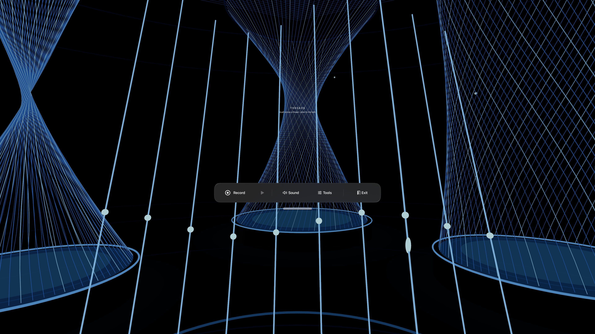
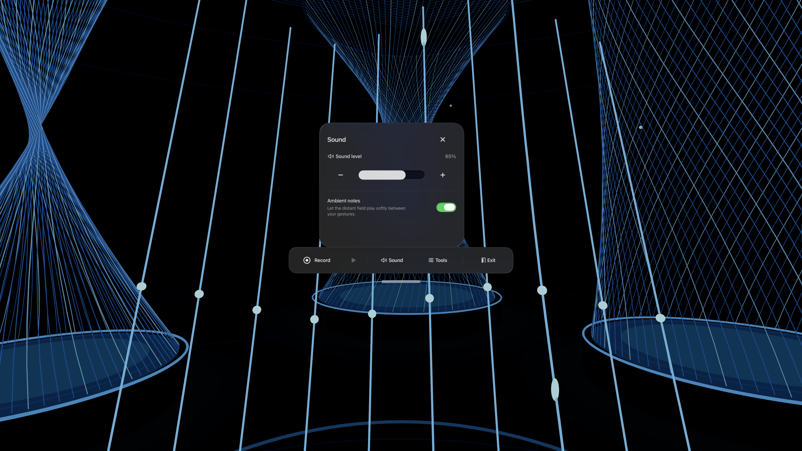
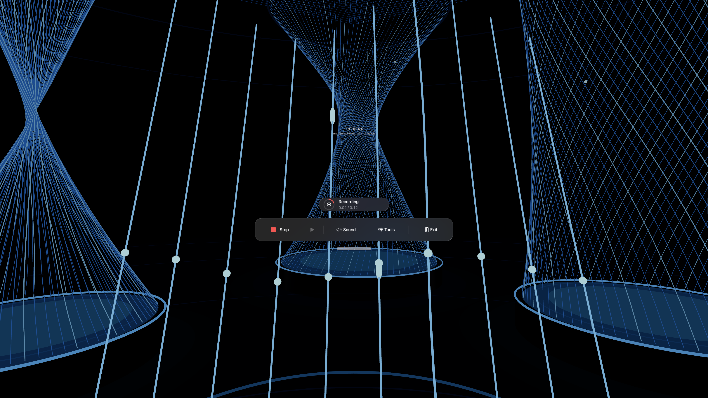

# Spatial controls — toolbar redesign

The toolbar is now a movable native visionOS window. Its initial placement uses the welcome window's location, with the system's regular front placement as a fallback. The wearer can move it using standard window controls. It stays where it is placed instead of following head movements.

## Interaction decisions

- **Five primary actions:** Record/Stop, Play/Pause, Sound, Tools, Exit. No permanently exposed miniature note keyboard or settings stack.
- **Comfortable selection targets:** primary label content has a minimum 60-point height; adjacent controls have 16-point layout gaps. Native buttons provide hover, press and keyboard focus feedback. Body and subheadline typography replace the former 8–11-point utility text.
- **Focused secondary tasks:** Sound and Tools use native popovers from the control window. Play controls and a short gesture guide are reached through Tools. They have explicit Close controls and scroll when their content needs more space.
- **Stable transport:** the loop-status area reserves its space, so beginning or ending a recording does not shift Record/Stop or Exit. Recording shows a label, stop icon, elapsed/maximum time and progress ring, rather than a flashing color alone.
- **Protection for musical work:** recording over an existing loop, resetting a nonempty field and leaving with a loop use native alerts with a cancel choice. Clear offers Undo for ten seconds. Undo restores a paused loop, preventing unexpected playback.
- **Recenter is separate from Reset:** Recenter moves the instrument while preserving notes, loop and playback state. Reset silences the instrument and discards the performance.
- **Secondary volume input:** a standard slider is supplemented by 5% decrease/increase buttons, useful for precise adjustment and for input methods that do not use dragging.
- **Less visual presence on request:** Tools → Minimize hides the main controls while preserving Controls and Exit. Loop status and a pending Undo can remain available. If the native window is closed using system controls, a small Show controls action in the field restores it.
- **No inferred gaze actions:** looking at a control does not trigger it. No custom gaze cursor, dwell timer, eye-position data, head-locked HUD or continuous panel repositioning is introduced.

## Why a native window

The simulator accepted the action to open a popover from the RealityView attachment but did not expose the presented control view. Apple's visionOS release notes also describe presentation-placement issues from attachments. Presenting the dock as a native window made its native popovers and alerts testable and reliable in the executed flow. The prototype now requires **visionOS 26 or later**, including presentation breakthrough support for legibility around 3D content.

The system's utility-panel placement was also visually inspected: it put this dock below the captured forward view. The final implementation uses the welcome window's existing front placement instead. This was a visual correction, not a claim that the system default is universally unsuitable.

## Verification scope

The updated suite contains 38 behavior/integration tests and one complete native UI test. The UI test exercises Sound, precise level adjustment, Ambient, Play controls, all three simulated gesture effects, recording, cancellation of replacement, pause, Clear/Undo, Recenter without losing a loop, cancellation of Exit, compact/expanded controls, Help, Reset, and return to the welcome window.

XCTest's slider-drag method could not obtain scrubber coordinates on this simulator, so the test verifies the slider is present and exercises the equivalent precise level buttons. Native slider dragging, headset gaze-hover quality, VoiceOver/Switch Control, large accessibility text sizes, and physical viewing comfort still need device checks. Source-level semantic type and scrolling support are present; they are not a substitute for those tests.

## Apple sources

- [Buttons](https://developer.apple.com/design/human-interface-guidelines/buttons): spatial selection regions, spacing, rounded shapes, native feedback.
- [Spatial layout](https://developer.apple.com/design/human-interface-guidelines/spatial-layout): visibility, comfortable movement and separation of interactive elements.
- [Designing for visionOS](https://developer.apple.com/design/human-interface-guidelines/designing-for-visionos): resting-hand indirect interaction and ergonomic placement.
- [Set the scene with SwiftUI in visionOS](https://developer.apple.com/videos/play/wwdc2025/290/): presentations in spatial scenes and breakthrough effects.
- [visionOS 26 release notes](https://developer.apple.com/documentation/visionos-release-notes/visionos-26-release-notes): source anchoring and known attachment-presentation issues.

## Captured final states

