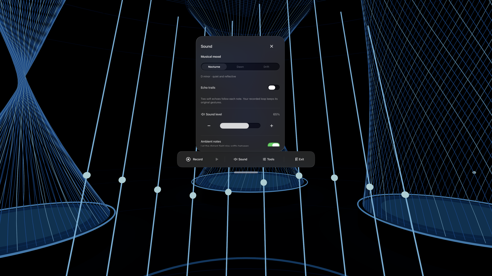
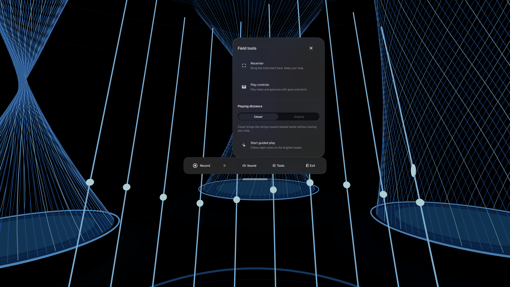

# THREADS 1.1 — hands, windows and musical exploration

1 November 2026.

## Reported problems and changes

The wearer reported unreliable open-palm waves and multiple overlapping control windows.

- A wave no longer depends on a narrow fixed box. The palm's swept path is checked against the ten foreground strings with an 18 cm proximity allowance. A 3.5 cm net sweep and a 0.8-second per-hand cooldown support relaxed movement while rejecting stationary hands, tracking jumps and distant gestures. Tiny back-and-forth tracking jitter cannot accumulate a wave. Wave feedback remains a brief harmonic swell.
- Missing ring or middle joints no longer discard an otherwise tracked index finger. Open-palm classification accepts two visibly extended fingers, and pinch capture requires a tracked thumb. Hand status is visible in the field and Tools. Restart hand tracking creates a fresh ARKit session and providers.
- Each immersive visit creates fresh providers instead of reusing stopped providers. Recenter, reach changes, interruption and tracking loss discard previous trajectories and held input. Slow fingertip brushes have a wider contact tolerance and support short high-rate tracking steps.
- Both welcome and controls are single-instance native `Window` scenes. A pending-open guard prevents repeated recovery requests before the control window appears. The foreground control surface remains movable and can be minimized.

## Four additions

1. **Musical moods:** Nocturne, Dawn and Drift retune the same acoustic bank to D minor, D major or A minor pentatonic. Visible note keys use the selected pitch names.
2. **Echo trails:** an optional two-note decaying tail. Echoes do not re-enter the recorder or recursively generate more echoes; queued old notes are dropped after a stall or pause.
3. **Guided play:** an eight-note phrase illuminates the next playable string. Incorrect notes do not advance it. Loop playback and echo voices cannot complete the phrase for the wearer. Free play and restart are available in Tools.
4. **Playing distance:** Closer brings the instrument 14 cm nearer and 10 cm lower, in the wearer's initial head direction. Original restores the previous placement. The instrument remains anchored rather than following the head; the performance loop is preserved.

## Simulator captures

## Verification

Simulator, signed physical-target build and privacy results are recorded in VERIFICATION.md and test-summary.json. Real hand tracking, gesture comfort and perceived audio still require a wearer to validate the new build. Synthetic hand samples test state and geometry; they are not physical tracking evidence.

No new data collection or external services were added. Signing configuration and raw diagnostic artifacts remain local.

## References

- [Presenting windows and spaces](https://developer.apple.com/documentation/visionos/presenting-windows-and-spaces) and [Window](https://developer.apple.com/documentation/swiftui/window) describe native scene presentation and single-instance windows.
- [HandAnchor originFromAnchorTransform](https://developer.apple.com/documentation/arkit/handanchor/originfromanchortransform) defines the hand-to-world transform used before conversion into instrument space.
